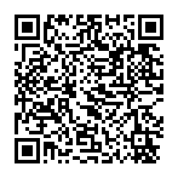

# Kotoba3DS

A Japanese dictionary that works inside your 3DS games. Press a button while playing: the 3DS
reads the text on the screen, you tap a word to look it up, and you can save it. Later, a
script on your PC turns the saved words into Anki cards, each with the sentence and a
screenshot of the game.

It runs on a modded New 3DS, New 3DS XL or New 2DS XL with Luma3DS, in any game. Reading and
looking up happen on the console itself: no PC or internet needed while you play.

**Latest version: 1.2.0.** Faster reading, installing over Wi-Fi with one zip, and no more
running out of memory in long sessions. See [CHANGELOG.md](CHANGELOG.md) for everything that
changed. **Already using Kotoba3DS?** See [UPDATING.md](UPDATING.md).

Massive thanks go to bee-san and the [vita-ocr](https://github.com/bee-san/vita-vn-ocr) model she built. Without it this project would not be possible!

## Contents

- [What it does](#what-it-does)
- [Quick start](#quick-start)
- [Install on the 3DS](#install-on-the-3ds)
- [Use it while playing](#use-it-while-playing)
- [Make Anki cards on your PC](#make-anki-cards-on-your-pc)
- [Files on the SD card](#files-on-the-sd-card)
- [Troubleshooting](#troubleshooting)
- [Build it yourself](#build-it-yourself)

## What it does

**On the 3DS**
- **Reads the screen for you.** Press **ZL + ZR** (or any buttons you choose) and the game
  pauses while the 3DS reads the text, in about a quarter of a second. The touchscreen, or both
  screens, can be read too, each with its own hotkey.
- **Finds text anywhere.** Dialogue boxes, speech bubbles, menus and subtitles over the game are
  all found. Furigana and the "next" arrow are left out, and the dictionary fixes kanji the
  reader wasn't sure of (造跡 → 遺跡).
- **Tap a word to look it up.** The full [Jitendex](https://jitendex.org) entry shows over the
  paused game, with the reading and how common the word is. Conjugated words are recognised
  (食べられなかった → 食べる).
- **Save words with one button.** The word is saved with its sentence and a screenshot. Saving
  is instant, and a mistaken save can be undone just as quickly.
- **Words you know show in green:** words you saved, words you marked as known, and the words of
  your Anki cards.

**On the PC** (optional)
- **Anki cards in one step.** Choose *Make Anki cards* on the 3DS, and every saved word becomes
  a [Lapis](https://github.com/donkuri/lapis) card over Wi-Fi: screenshot, sentence, definition,
  pitch accent, frequency and audio. Words you already have cards for are skipped.
- **Your Anki words on the 3DS**, so they show in green in lookups.

## Quick start

1. **Install it:** extract **Kotoba3DS-SD.zip** from the
   [latest release](../../releases/latest) to the root of your SD card, over Wi-Fi with 3dsDL
   or with a card reader ([details below](#install-on-the-3ds)).
2. **Turn on Luma's plugin loader:** open the Rosalina menu (**L + D-Pad Down + Select**) and set
   **Plugin loader: [Enabled]**.
3. **Start a game**, wait a few seconds, and press **ZL + ZR** when there's text on the top
   screen. Tap a word to look it up, **A** to save it, **B** to go back to the game.
4. **Press Select** in a game for the plugin's menu: other hotkeys, reading modes, your saved
   words, and *Make Anki cards*.

## Install on the 3DS

You need a New 3DS, New 3DS XL or New 2DS XL with [Luma3DS](https://github.com/LumaTeam/Luma3DS)
(custom firmware). Making Anki cards over Wi-Fi needs Luma v13.2 or newer.

Everything comes in one zip, **Kotoba3DS-SD.zip**, with the files already in their folders:
the plugin, the dictionary (`dict.bin`, ~55 MB) and the OCR models.

### Install over Wi-Fi with 3dsDL

No SD card reader needed. [3dsDL](https://ankush.one/3dsDL/) downloads files straight onto the
SD card; install it once with FBI (**Remote Install → Scan QR Code**, with the code on its page).

1. In 3dsDL, scan this code, or type the link under it. Keep the download folder at the root of
   the SD card (`sdmc:/`, 3dsDL's default).

   

   `https://github.com/icebreaker2718/kotoba-3ds/releases/latest/download/Kotoba3DS-SD.zip`
2. In **Files**, pick **Kotoba3DS-SD.zip** → **Extract** → **Here**.
   (With **Settings → Ask to Extract** on, 3dsDL offers this as soon as the download ends.)
3. If it asks about files that already exist, choose **Overwrite**. Your saved words,
   screenshots and settings aren't in the zip, so they're kept. (This also replaces any other
   plugin you had as `default.3gx`.)
4. **Delete Archive** frees the space.

### Or with an SD card reader

Download **Kotoba3DS-SD.zip** from the [latest release](../../releases/latest) and extract it
to the root of the SD card. Or copy the files one by one:

| File (from the release) | Put it at |
|---|---|
| `Kotoba3DS.3gx` | `SD:/luma/plugins/default.3gx` (every game), **or** `SD:/luma/plugins/<TitleID>/Kotoba3DS.3gx` (one game) |
| `dict.bin` | `SD:/3ds/kotoba3ds/dict.bin` |
| `Kotoba3DS-ocr-model.zip` | unzip to the root of the SD card (it makes `SD:/3ds/kotoba3ds/ocr/`) |

### Turn it on

Open the Rosalina menu (**L + D-Pad Down + Select**), set **Plugin loader: [Enabled]**, and
start a game. After a few seconds the plugin is ready; press **Select** to open its menu.

> The plugin turns off CTRPF's cheat and search tools; only its own menu is shown.

## Use it while playing

### Look up a word

1. When a line has a word you don't know, press **ZL + ZR**. The game pauses and the 3DS reads
   the top screen. (For the touchscreen, set a hotkey for *Read the touchscreen* or *Read both
   screens* in the Select menu.)
2. The text appears in large type on the touchscreen. **Tap a word**: its dictionary entry shows
   on the top screen over the dimmed game, with the word in yellow, its reading in blue, how
   common it is (its [JPDB](https://jpdb.io) rank, like #1,234) and, for a conjugated word, the
   conjugation. (The layout follows [Rubi for Vita](https://github.com/bee-san/Rubi_for_vita)'s.)
3. Press **A** to save the word, or **B** to close and go back to the game.

| Button | Does |
|---|---|
| Tap a character | look up the word starting there |
| Circle Pad ◀ ▶ | previous / next word (hold to keep going) |
| Circle Pad ▲ ▼ | the line above / below |
| D-Pad ▲ ▼ (or C-Stick) | scroll a long definition |
| D-Pad ◀ ▶ (or L / R) | other matches at the same spot (shown as 1/3): words spelled the same, most common first, then shorter words |
| **A** (or the Save button) | save the word; press again on a word you just saved to undo |
| **Y** | mark the word as known without saving it (grammar, words you already know); Y again undoes it |
| **X** (or Hide) | see the game behind the lookup (see-through or hidden, set under *Hide (X)*); X again to come back |
| **Start** | keep the screenshot without saving a word, for a screen that was read wrong (Start again undoes it) |
| **B** (or Close) | close; the game continues once you let go of the buttons |

If the screen had several pieces of text (two speech bubbles, or a menu and a dialogue box),
they're all listed, top to bottom, with a line between them.

### Saved words

**Save** writes the word to `mined.tsv` on the SD card with its sentence and a screenshot of the
screen(s) that were read. Saving never needs a PC: the words wait on the card until you make
cards. *Saved words* in the Select menu lists them with their entries (Y deletes one).

### Words in green

Words you've saved, words you marked with **Y**, and the words of your Anki cards (once you've
used *Known words*, below) show in green wherever they appear. The list of Anki words can be as
long as you like: it's looked up on the SD card, not loaded into memory.

### Three ways to read the screen

| Mode | What it reads | Best for |
|---|---|---|
| **Normal** (the default) | every line of text on the screen, wherever it is | most games: dialogue, speech bubbles, subtitles over the scene |
| **Text boxes only** | only text boxes of one flat colour (most dialogue boxes) | games where menu text or labels get in the way; may miss text over the scene or in shaded bubbles |
| **Reading area** | one part of the screen that you choose, per game | games whose text is always in the same place (a fixed dialogue box, subtitles); the quickest and cleanest |

To set a reading area, pause a game with text showing, open **Select → Reading area** and press
**A**:

| Button | Does |
|---|---|
| D-Pad | move the area |
| L + D-Pad | resize it |
| Hold R | bigger steps |
| Stylus | draw the area (touchscreen) |
| X | switch to the other screen |
| A | save |
| Y | clear it (read the whole screen again) |
| B | back without saving |

The area is saved for this game and this screen only. Leave a little room around the text, since
later lines may be longer. If a lookup comes up empty or cut off, the text was probably outside
the area.

### The Select menu

| Item | Does |
|---|---|
| *Read the top screen* / *Read the touchscreen* / *Read both screens* | set each one's hotkey: hold the button(s) you want, then let go (or *Turn off*) |
| *Touchscreen text shows on* | where the text of a touchscreen read goes: the touchscreen (tap the words) or the top screen (the entry then goes on the touchscreen) |
| *Hide (X)* | what X does: see-through, hidden, or see-through then hidden |
| *Saved words are written* | in kanji (the word's usual spelling, even if the game used kana: ちょっと → 一寸) or as in the game (たべた → たべる) |
| *Text boxes only* | on / off (see the reading modes above) |
| *Reading area* | set or clear this game's reading area |
| *Last lookup* | reopen the text of your last lookup |
| *Saved words* | review your saved words; Y deletes one |
| *Make Anki cards* | send the saved words to your PC (below) |
| *Known words* | get the words of your Anki cards from your PC; forget that list, or forget the words marked with Y |
| *PC* | find your PC, or type its address |
| *How to use* | the controls in short |

### Good to know

- **Speed:** while a lookup is open, the console runs at full speed and uses all its CPU
  cores to read; the game's own setting comes back when you close it.
- **The OCR** is VOCR6 from bee-san's [vita-vn-ocr](https://github.com/bee-san/vita-vn-ocr),
  the same reader [Rubi](https://github.com/bee-san/Rubi_for_vita) uses on the PS Vita, trained
  for game dialogue. Its line spotter (textspot8) finds the text. The model files are for
  **non-commercial use only**.
- **A screen that couldn't be read** is kept as `shots/failed_*.qoi`, which helps when reporting
  a problem. Each read is also noted in `SD:/3ds/kotoba3ds/ocr_log.txt`.

## Make Anki cards on your PC

This part is optional: the 3DS keeps your saved words until you're ready. When you are, a small
program on your PC turns them into Anki cards. Each card gets the word, its reading, the
sentence from the game, a screenshot, the dictionary definition, pitch accent, frequency and
audio.

**You need:**
- a Windows, Mac or Linux PC on the same Wi-Fi network as the 3DS (the 3DS only uses 2.4 GHz);
- [Anki](https://apps.ankiweb.net) (the desktop app);
- [Python](https://www.python.org/downloads/) 3.9 or newer;
- internet on the PC, for the word audio.

### Set it up (once)

**1. Install Python.** Download it from [python.org](https://www.python.org/downloads/) and
install it. On Windows, tick **"Add python.exe to PATH"** on the installer's first screen.

**2. Download the PC tools.** On this page, click **Code → Download ZIP**, then unzip it
somewhere you'll find again, like your Documents folder. You get a folder called
`kotoba-3ds-main` with a `tools` folder inside.

**3. Open a terminal in that folder.** Every command below is typed there.
- Windows: open the `kotoba-3ds-main` folder, click the address bar, type `cmd` and press Enter.
- Mac: right-click the folder in Finder → **New Terminal at Folder**.
- Linux: right-click in the folder → **Open in Terminal**.

**4. Install Pillow** (it makes the screenshot for each card):

```
python -m pip install pillow
```

On Windows, if `python` isn't found, type `py` instead of `python` here and in every command
below.

**5. Set up Anki.**
1. In Anki, go to **Tools → Add-ons → Get Add-ons**, enter `2055492159` (AnkiConnect), and
   restart Anki. AnkiConnect is what lets the tools add cards.
2. Get the **Lapis** note type, which lays out the cards: download the `.apkg` file from
   [Lapis' releases](https://github.com/donkuri/lapis/releases) and open it with
   **File → Import**. If you already make Lapis cards, skip this.

**6. Add dictionaries.** Make a folder named `dictionaries` inside `tools`, and put Yomitan
dictionary `.zip` files in it, without unzipping them. (If you use Yomitan, these are the same
files.)

| Dictionary | Gives the card | Where to get it |
|---|---|---|
| **Jitendex** (recommended) | the definition | `jitendex-yomitan.zip` from [jitendex.org](https://jitendex.org) |
| a pitch accent dictionary | the pitch accent graph | for example **[Pitch] NHK2016** from [MarvNC's collection](https://github.com/MarvNC/yomitan-dictionaries) |
| a frequency dictionary (optional) | how common the word is | for example JPDB from [jpdb-freq-list](https://github.com/MarvNC/jpdb-freq-list/releases) |

Without a definition dictionary, cards still get the short definition from the 3DS, tagged so
you can fill them in later.

**7. Run the setup check.** Open Anki, then type:

```
python tools/mine.py setup
```

It creates the settings file `tools/config.json`, checks that the Lapis note type is there,
creates the deck **Mining Deck** if you don't have one, and reads your dictionaries (a minute or
two the first time). When it's done, the last lines list the dictionaries it found. If it says
the Lapis note type is missing, do step 5.2 and run it again.

Setup is done. You don't need to repeat it.

> To put the cards in another deck, open `tools/config.json` in a text editor and change
> `"deck": "Mining Deck"` to your deck's name.

### Make cards

1. **On the PC:** open Anki, then in the terminal (step 3) type:

   ```
   python tools/ocr_server.py
   ```

   Leave this window open while you make cards. It prints the PC's address, for example
   `192.168.1.20:7331`. The first time, if Windows asks whether Python may use the network, allow
   it on **private networks**.
2. **On the 3DS:** in a game, press **Select → Make Anki cards**. Each saved word is sent and
   becomes a card in Anki. Words you already have cards for are skipped. At the end the 3DS says
   how many cards were made, and offers to remove those words from *Saved words* (their
   screenshots stay on the SD card).
3. **When you're done**, close the terminal window (or press **Ctrl + C** in it).

The 3DS finds the PC by itself. If it can't, go to **Select → PC → Type its address** and enter
the address the PC printed.

### Show your Anki words in green

With `python tools/ocr_server.py` running, choose **Select → Known words → Get them from my PC**
on the 3DS. The words of all your Anki notes are copied to the 3DS, and they show in green in
lookups from then on. Do this again whenever you want the list brought up to date. Words that
*Make Anki cards* turns into cards are added on their own.

### Without Wi-Fi: ftpd or an SD card reader

If the 3DS can't reach your PC over Wi-Fi, `mine.py` can read the saved words straight from the
SD card instead. Do the setup above first (`ocr_server.py` isn't needed for this).

- **With an SD card reader:** close the game, turn off the 3DS, put the card in the PC, open
  Anki, and type (with your card's drive or folder instead of `E:/`):

  ```
  python tools/mine.py --sd E:/
  ```

- **Over Wi-Fi with ftpd** (install ftpd on the 3DS from Universal-Updater): close the game,
  open ftpd, open Anki, and type the address ftpd shows on the 3DS's screen:

  ```
  python tools/mine.py --ftp 192.168.1.50:5000
  ```

To skip typing it each time, put the drive in `source.sd_root` or the address in
`source.ftp_host` in `tools/config.json`, then just type `python tools/mine.py`.

Add `--dry-run` to see what would be made without making cards, or `--clear` to remove the
imported words from the 3DS afterwards. `mine.py` remembers what it imported
(`tools/imported.json`), so running it twice never makes duplicate cards.
`python tools/mine.py known` copies your Anki words to the 3DS, like *Known words* above.

### Customize the cards

Everything below is optional, and set in `tools/config.json`.

#### Game names on cards

In `tools/config.json`, `games` maps a title ID to a game name. The name goes into the card's
`MiscInfo` field and becomes its tag. Your first card shows the game's title ID in `MiscInfo`.

#### Which words count as known

*Known words* takes the word from each note's `Expression` field (or `Word`, `Vocab`,
`Vocabulary`, `Term`, `Kanji`, `Japanese`, `Front`: the first one the note has), without
furigana or HTML. To choose which notes and fields, set `known.query` (an Anki search, like
`"deck:Mining Deck"`) and `known.fields` in `config.json`.

#### What goes in each Lapis field

| Field | Filled with |
|---|---|
| Expression / ExpressionReading | the word and its reading |
| ExpressionFurigana | `食[た]べる` (Anki furigana format, like Yomitan's `{furigana-plain}`) |
| ExpressionAudio | word audio (see below) |
| MainDefinition, Glossary | the Jitendex entry, with the same HTML and styling as Yomitan's |
| Sentence | the sentence from the game, with the word in bold |
| Picture | the screenshot of the screen(s) that were read, at 2× |
| PitchPosition / PitchCategories | for example `[2]` / `kifuku`, which Lapis turns into the pitch graph and colours |
| Frequency / FreqSort | from your frequency dictionaries (harmonic rank, like Yomitan) |
| MiscInfo | the game's name and the time |
| Is…Card, SentenceFurigana, SentenceAudio, Hint, … | left empty (a normal vocab card) |

To change this, edit `anki.fields` in `config.json`. Each value is a template using these
placeholders: `{expression} {reading} {furigana} {audio} {definition_html} {definition}
{sentence} {picture} {pitch_position} {pitch_categories} {frequency} {freq_sort} {game}
{game_tag} {time} {inflection} {query} {title_id}`. For example, `"IsWordAndSentenceCard": "x"`
makes every card a word + sentence card.

#### Cards to finish by hand

A card whose word isn't in any of your dictionaries (it gets the 3DS's short definition instead)
is tagged `no_definition`; one with no audio is tagged `no_audio`. Both also get **flag 1
(red)**, so you can find them in the Anki browser (*Flag → Red*, or search `tag:no_definition`
/ `tag:no_audio`). Change the tags with `missing_definition_tag` and `missing_audio_tag` in the
`anki` section of `config.json` (`""` for none), and the flag with `flag_missing` (0 turns it
off; 2 = orange, 3 = green, 4 = blue…). If Anki has the card open in an editor, the flag is set
once the editor closes.

#### Word audio

`audio.sources` in `config.json` is tried in order for each word, until one has a recording:

```json
"sources": ["local", "jpod101", "jpod101-alt", "lingualibre", "forvo"],
"forvo_key": ""
```

| Source | What it is |
|---|---|
| `"local"` | **Local Audio Server for Yomitan** (an Anki add-on with offline NHK, Shinmeikai, Forvo and JPod recordings) at `http://127.0.0.1:5050`. Used when it's running, skipped when it isn't. The best free way to get Forvo audio. |
| `"jpod101"` | JapanesePod101's word recordings (Yomitan's default). Needs internet. |
| `"jpod101-alt"` | JapanesePod101's dictionary search, which sometimes has words the first one doesn't. |
| `"lingualibre"` | native-speaker recordings from [Lingua Libre](https://lingualibre.org). Free, fewer words. |
| `"forvo"` | [Forvo](https://forvo.com) through its official API. Needs your own key from [api.forvo.com](https://api.forvo.com) (a paid plan) in `forvo_key`. |

Reorder or remove entries as you like. Any other URL works too, using `{term}` and `{reading}`,
as long as it returns an audio file or Yomitan's JSON audio-source list:

```json
{"name": "my server", "url": "http://example.com/audio?term={term}&reading={reading}"}
```

## Files on the SD card

```
/luma/plugins/default.3gx      the plugin
/3ds/kotoba3ds/dict.bin        the dictionary
/3ds/kotoba3ds/ocr/            the OCR models
/3ds/kotoba3ds/mined.tsv       your saved words
/3ds/kotoba3ds/shots/          screenshots of the screens you read
/3ds/kotoba3ds/known.txt       the words of your Anki cards (green in lookups)
/3ds/kotoba3ds/marked.txt      words you marked known with Y
/3ds/kotoba3ds/areas.txt       your reading areas, per game
/3ds/kotoba3ds/settings.txt    hotkeys and the menu's choices
/3ds/kotoba3ds/ocr_log.txt     a note of each read, for bug reports
```

## Troubleshooting

When reporting a problem, please include `SD:/3ds/kotoba3ds/ocr_log.txt` and, for a screen that
was read wrong, its screenshot from `SD:/3ds/kotoba3ds/shots/` (press **Start** on the lookup
screen to keep one).

**On the 3DS**
- **The menu doesn't open:** check that the plugin loader is enabled, that the plugin is at
  `SD:/luma/plugins/default.3gx` (or in the game's title ID folder), and wait about 5 seconds
  after the game starts.
- **The game crashes or shows an error at start:** update to the latest release. If it still
  happens, turn the plugin loader off in the Rosalina menu to play, and please report the game.
- **"Dictionary not found":** the file must be exactly `SD:/3ds/kotoba3ds/dict.bin`.
- **"wrong format / truncated":** download `dict.bin` (or the SD zip) again and copy it again.
- **"Couldn't read the screen: No OCR model found":** extract Kotoba3DS-SD.zip (or
  `Kotoba3DS-ocr-model.zip`) to the root of the SD card.
- **"Not enough memory" messages:** update to 1.2.0, which fixes running out of memory in long
  sessions. If it still happens, please report it with the log.
- **Japanese shows as boxes:** the plugin uses the console's system font. Please report it, with
  your console's region.

**Making cards**
- **Cards aren't sent to the PC:** check that `ocr_server.py` is running and that Windows
  Firewall allows Python on private networks, then type the address it prints under
  **Select → PC**. The 3DS only uses 2.4 GHz Wi-Fi. Your saved words are kept either way.
- **"networking needs Luma3DS v13.2 or newer":** update Luma (its version shows at the top of the
  Rosalina menu).
- **"network unavailable in this game":** some games don't let plugins use the network. Lookups
  still work; make the cards later with `mine.py` over ftpd or a card reader.
- **mine.py can't connect:** ftpd must be open on the 3DS, with the PC on the same network.

## Build it yourself

Most people don't need this: the [latest release](../../releases/latest) has everything ready.

### Let GitHub build it (no tools to install)

1. Fork this repository.
2. Open the **Actions** tab. The `build` workflow starts on its own (or press *Run workflow*).
3. When it's green, download the **Kotoba3DS-plugin**, **Kotoba3DS-dict** and
   **Kotoba3DS-ocr-model** artifacts from the run's page.

### Build the plugin on your PC

Install [devkitPro](https://devkitpro.org/wiki/Getting_Started) with the 3DS tools, then add the
CTRPluginFramework package repository and install it with 3gxtool:

```sh
# Windows: run inside C:/devkitPro/msys2/msys2_shell.bat and use pacman.
# Linux/macOS: use dkp-pacman; the config is /opt/devkitpro/pacman/etc/pacman.conf
cat >> /opt/devkitpro/pacman/etc/pacman.conf <<'EOF'

[thepixellizeross-lib]
Server = https://thepixellizeross.gitlab.io/packages/any
SigLevel = Optional

[thepixellizeross-linux]
Server = https://thepixellizeross.gitlab.io/packages/x86_64/linux
SigLevel = Optional
EOF
# on Windows use [thepixellizeross-win] with .../packages/x86_64/win instead of -linux
dkp-pacman -Sy libctrpf 3gxtool
make -C plugin            # -> plugin/Kotoba3DS.3gx
```

Keep the project's path free of spaces.

### Build your own dictionary

`dict.bin` can be built from Jitendex, JMdict or any Yomitan dictionary (Python 3.9+):

```sh
pip install jamdict jamdict-data        # provides RADKFILE (kanji parts) and a fallback JMdict

# From Jitendex (recommended): jitendex-yomitan.zip from https://jitendex.org, with JPDB's
# frequency ranks (shown as #1,234 on the 3DS; words spelled the same are listed most common
# first) from https://github.com/Kuuuube/yomitan-dictionaries (JPDB v2.2 Frequency Kana)
python tools/build_dict.py --yomitan jitendex-yomitan.zip --freq JPDB_v2.2_Frequency_Kana_2024-10-13.zip -o dict.bin

# Any Yomitan term dictionary works the same way: repeat --yomitan to combine several, and
# add --freq <frequency dictionary .zip> to list common words first.

# Or plain JMdict:
python tools/build_dict.py -o dict.bin                       # the bundled copy
python tools/build_dict.py --jmdict JMdict_e.gz -o dict.bin  # the current one from EDRDG
```

### Developing

- `plugin/Sources/core/`: platform-independent C++, built both for the 3DS and for the tests.
- `plugin/Sources/main.cpp`: the menus, hotkeys and lookup screens (CTRPF).
- `tests/`: native tests of the core against a real `dict.bin`: `make -C tests run DICT=../dict.bin`.
  Also `python tests/test_builder.py <jamdict.db>` and
  `python tests/test_mine.py [jitendex-yomitan.zip]` (needs `pip install pyftpdlib pillow`).
- `tools/yomitan.py`: Yomitan dictionary reader and HTML renderer; `tools/enrich.py`: the card's
  extras (definitions, pitch, frequency, audio, furigana).

## Credits & licences

- On-device OCR: the VOCR runtime, the VOCR6 and VOCR5 models and the textspot8 line spotter of
  [bee-san/vita-vn-ocr](https://github.com/bee-san/vita-vn-ocr) (GPL-3.0-or-later; the model
  weights are for non-commercial use only, see the attribution files that come with them), the
  OCR of [Rubi](https://github.com/bee-san/Rubi_for_vita).
- [JMdict](https://www.edrdg.org/jmdict/j_jmdict.html) and
  [RADKFILE](https://www.edrdg.org/krad/kradinf.html) are property of the Electronic Dictionary
  Research and Development Group, used under CC BY-SA 4.0.
- [Jitendex](https://jitendex.org) by Stephen Kraus, CC BY-SA 4.0 (includes Tatoeba examples,
  CC BY 2.0 FR). Card layout by [Lapis](https://github.com/donkuri/lapis).
- Built on [CTRPluginFramework](https://gitlab.com/thepixellizeross/ctrpluginframework)
  (The Pixellizer Group licence) and [Luma3DS](https://github.com/LumaTeam/Luma3DS)'s plugin
  loader.
- Conjugation handling follows the approach of [Yomitan](https://github.com/yomidevs/yomitan).

## Licence

Kotoba3DS is free software under the GNU General Public License v3.0 or later ([LICENSE](LICENSE)),
because it includes the GPL-licensed VOCR runtime. The dictionaries, the OCR models and the
third-party code keep their own licences (above).
